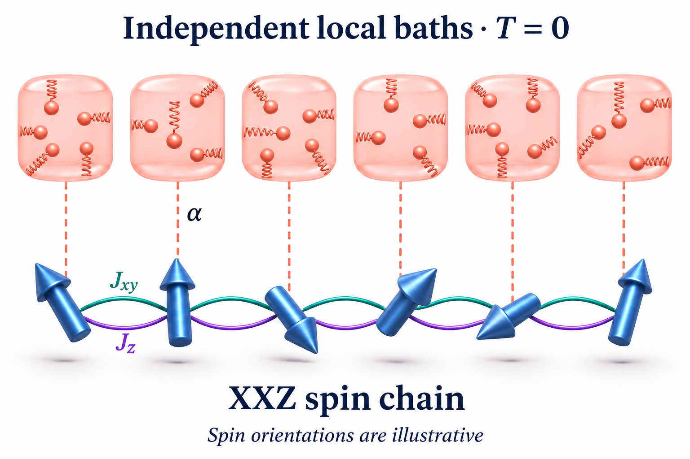

# Langevin Monte Carlo for a dissipative XXZ spin chain

Research code associated with Saptarshi Majumdar's doctoral work on quantum spin chains coupled to local dissipative baths.

*Each spin couples to its own independent oscillator bath at zero temperature; α measures the spin–bath coupling strength. Teal Jxy bonds represent transverse exchange, Jxy(SxᵢSxᵢ₊₁ + SyᵢSyᵢ₊₁), while purple Jz bonds represent longitudinal exchange, Jz SzᵢSzᵢ₊₁. Their different heights distinguish the two terms acting on the same neighboring sites, rather than separate spatial paths. Spin directions and oscillator arrangements are illustrative and do not specify a phase. AI-generated illustration inspired by Figure 1 of [Majumdar et al., arXiv:2210.01590](https://arxiv.org/abs/2210.01590).*

## Research context

We investigate the zero-temperature phase diagram of a one-dimensional XXZ spin chain in which each spin couples to an independent bath of harmonic oscillators: a many-body extension of the spin-boson model. Bosonization and a path-integral formulation map the quantum problem onto a classical field theory in one spatial dimension and imaginary time. Integrating out the baths produces a cosine interaction that is local in space and long-ranged along imaginary time.

The associated papers explore how dissipation changes ordering and transport:

- At finite, incommensurate magnetization, coupling to the baths can drive a transition from a Luttinger liquid to a gapless spin density wave. For subohmic baths, the ordered phase has vanishing DC conductivity, interpreted as bath-induced localization [2].
- At zero magnetization, the phase diagram contains a Luttinger liquid and a gapped antiferromagnetic phase. Subohmic dissipation can drive the ordering transition; for superohmic baths, interactions within the chain drive the transition [1].
- For Ohmic baths, the dissipative phase has vanishing spin stiffness and finite resistivity, distinct from the vanishing DC conductivity found for subohmic baths [3].

## Current implementation

[`LL_diss_modified_par.cpp`](LL_diss_modified_par.cpp) evolves a real field on a discrete space–imaginary-time lattice using an explicit Langevin update with Gaussian noise. The Langevin evolution time is a sampling variable, distinct from the lattice's imaginary-time coordinate and from physical real time.

The source includes periodic discrete Laplacians in both lattice directions, a bath-induced sine force between field values at the same spatial site, and measurements of spatial and imaginary-time field roughness. It writes averaged roughness values and sampled field configurations to `.dat` files.

This is an archival implementation, rather than a complete reproduction package for all three papers:

- Parameters are set directly in `main`; the current lattice has `L = beta = 20`.
- `Kernel` implements a fixed Ohmic kernel. The variable `s` appears in output filenames but does not change the dynamics.
- The active dissipative force uses the sine interaction, although output filenames contain `harmonic`.
- MPI initializes multiple processes, but there is no rank-specific output naming or collective averaging. Multiple ranks would write to the same files; use a single process with this version.
- No separate commensurate pinning term for the zero-magnetization problem is implemented.

## Dependencies and validation

The source requires a C++ compiler, Eigen headers, and an MPI implementation. It uses variable-length stack arrays, which are a compiler extension rather than standard C++. No build or numerical validation has yet been performed for this repository, and no simulation data or figure-reproduction scripts are included.

## Related publications

1. Oscar Bouverot-Dupuis, Saptarshi Majumdar, Alberto Rosso, and Laura Foini, **Antiferromagnetic order enhanced by local dissipation**, *Physical Review B* **109**, 205148 (2024). [arXiv:2312.13095](https://arxiv.org/abs/2312.13095) · [Published article](https://doi.org/10.1103/PhysRevB.109.205148).
2. Saptarshi Majumdar, Laura Foini, Thierry Giamarchi, and Alberto Rosso, **Localization induced by spatially uncorrelated subohmic baths in one dimension**, *Physical Review B* **108**, 205138 (2023). [arXiv:2307.07989](https://arxiv.org/abs/2307.07989) · [Published article](https://doi.org/10.1103/PhysRevB.108.205138).
3. Saptarshi Majumdar, Laura Foini, Thierry Giamarchi, and Alberto Rosso, **Bath induced phase transition in a Luttinger liquid**, *Physical Review B* **107**, 165113 (2023). [arXiv:2210.01590](https://arxiv.org/abs/2210.01590) · [Published article](https://doi.org/10.1103/PhysRevB.107.165113).
